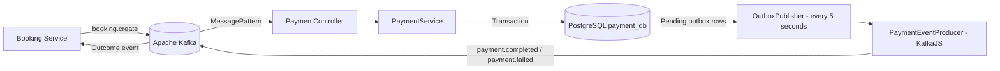

# Payment Service — Event Ticketing System

## Overview

The **Payment Service** is a NestJS microservice in the Event Ticketing System. It consumes booking payment requests from Apache Kafka, records payment results in PostgreSQL, prevents duplicate event processing, and reliably stages payment outcome events for asynchronous publication using the **Transactional Outbox Pattern**.

> **Current implementation scope:** Payment outcomes are determined by an internal placeholder rule (`totalPrice > 0` produces `SUCCESS`; otherwise `FAILED`). **No real payment gateway, card charge, capture, or refund workflow is implemented.** The DTO validates positive amounts, so nonpositive amounts should be rejected when validation is applied; the failed-payment branch remains in the service logic and is covered by unit-level scenarios. Kafka is the payment-processing entry point; the existing NestJS HTTP bootstrap and starter controller do **not** expose a payment-processing REST endpoint.

## Responsibilities

- Consume `booking.create` events from Kafka.
- Enforce event-level idempotency using `processed_events.event_id`.
- Prevent conflicting payment requests for the same booking.
- Persist payment records and processing status.
- Write payment outcomes to the outbox within the **same database transaction** as the payment record.
- Publish `payment.completed` and `payment.failed` messages through KafkaJS.
- Retry failed outbox publications and mark events failed after the configured attempt threshold.

## Tech Stack

| Technology | Version / Role |
|---|---|
| Node.js | Runtime (Node.js 24.21.0 used in the recorded tests) |
| TypeScript | 5.7.3 (declared project version) |
| NestJS | 11.x |
| NestJS Microservices | 11.2.6 (Kafka consumer transport) |
| TypeORM | 1.1.1 (declared dependency) |
| PostgreSQL | PostgreSQL 16.15 used in local Docker test environment |
| `pg` | 8.23.0 |
| KafkaJS | 2.2.4 |
| `@nestjs/schedule` | Scheduled outbox publishing |
| `class-validator` | DTO validation decorators |
| Jest | 30.x (unit and integration tests) |
| ESLint | 9.x |
| Prettier | 3.4.2 |

*Version entries reflect supplied project configuration and the recorded test environment, not a guarantee of all installed patch versions.*

## Architecture



The service runs a NestJS Kafka microservice consumer and an HTTP application bootstrap. The `PaymentController` handles the Kafka message pattern, **not an HTTP POST payment endpoint**. The HTTP application sets an `/api/v1` global prefix and defaults to port `8084`; the supplied source does not establish an API Gateway-to-payment HTTP processing route.

### Key components

| Component | Role |
|---|---|
| `PaymentController` | Receives Kafka `booking.create` messages; delegates to `PaymentService`. |
| `PaymentService` | Handles idempotency, booking conflicts, persistence, and transaction commit/rollback. |
| `PaymentEntity` | Stores booking-to-payment relationship, amount, currency, status, and idempotency key. |
| `ProcessedEventEntity` | Records consumed `eventId` values. |
| `OutboxEventEntity` | Stores payment outcome messages pending Kafka publication. |
| `OutboxPublisher` | Every 5 seconds reads up to 20 pending events with row locking and `SKIP LOCKED`. |
| `PaymentEventProducer` | Connects a KafkaJS producer; sends booking-keyed outcome messages using `acks: -1`. |
| `data-source.ts` | TypeORM CLI DataSource for database migrations. |

## Processing Flow

1. Booking Service emits a `booking.create` Kafka message.
2. `PaymentController.handleBookingCreated()` receives the `ProcessPaymentDto` and calls `PaymentService.processBookingPayment()`.
3. `PaymentService` opens a TypeORM `QueryRunner` transaction.
4. It inserts the `eventId` into `processed_events` with `ON CONFLICT DO NOTHING`; an already-processed event is ignored.
5. It looks up any payment for the `bookingId`. A matching existing payment is treated as an idempotent repeat; conflicting details cause an error and rollback.
6. For a new booking, it creates a payment with `SUCCESS` or `FAILED` under the current placeholder business rule.
7. It writes a `PENDING` event to `outbox_events` in the **same transaction**.
8. It commits and releases the transaction.
9. Every 5 seconds, `OutboxPublisher` selects up to 20 `PENDING` outbox rows, ordered by creation time, under a pessimistic lock with `SKIP LOCKED`.
10. `PaymentEventProducer` sends the event to Kafka. The outbox row becomes `PROCESSED` when sending succeeds, or its retry count is incremented on a send error. At 5 failed attempts it becomes `FAILED`.

**Delivery semantics:** This is designed for **at-least-once** event publication rather than exactly-once end-to-end processing. A send/commit interruption may produce duplicate Kafka outcomes; consumers should be idempotent. The publisher currently performs Kafka I/O while its database transaction is open.

## Kafka Contracts

### Incoming: `booking.create`

The DTO expects this shape (illustrative IDs):

```json
{
  "eventId": "0ca5096e-0d1e-4be4-9ed9-89da8e129b88",
  "bookingId": "35af9672-4b87-43e7-837c-efc4711a8cbc",
  "userId": "ca0ac379-2431-421f-aa99-60e04df5dc3f",
  "totalPrice": 200.25,
  "currency": "USD",
  "idempotencyKey": "booking-35af9672-payment"
}
```

`ProcessPaymentDto` declares UUID validation for IDs; positive numeric amount with at most two decimal places and maximum `99999999.99`; three uppercase currency letters; and a nonblank idempotency key of up to 255 characters. **The supplied `main.ts` does not register a global `ValidationPipe`**, so these decorators alone do not establish that every incoming Kafka event is automatically rejected when invalid.

### Outgoing: `payment.completed` / `payment.failed`

An outbox event payload includes `paymentId`, `bookingId`, `userId`, `amount` (decimal string), `currency`, and `status`. At publication time the Kafka message value is JSON with `eventId` and `eventType` added; its Kafka message key is the booking ID.

```json
{
  "eventId": "8043ba08-5768-4347-9cc5-931d3ab31049",
  "eventType": "payment.completed",
  "paymentId": "184c9457-5dc2-457c-aa9f-cd0b7441b04d",
  "bookingId": "35af9672-4b87-43e7-837c-efc4711a8cbc",
  "userId": "ca0ac379-2431-421f-aa99-60e04df5dc3f",
  "amount": "200.25",
  "currency": "USD",
  "status": "SUCCESS"
}
```

The example `eventId` above is the **outbox record ID**, not necessarily the incoming booking event ID. Topics must exist because the KafkaJS producer has `allowAutoTopicCreation: false`.

## Database Design

| Table | Important fields | Purpose |
|---|---|---|
| `payments` | `id`, unique `booking_id`, `user_id`, `amount`, `currency`, `status`, unique `idempotency_key`, `failure_reason`, timestamps | Payment state |
| `processed_events` | primary key `event_id`, `event_type`, `processed_at` | Deduplication of consumed booking events |
| `outbox_events` | `id`, `aggregate_type`, `aggregate_id`, `type`, `payload` (JSONB), `status`, `retry_count`, timestamps | Reliable asynchronous outcome publishing |

**Payment entity statuses:** `PENDING_PAYMENT`, `SUCCESS`, `FAILED`, `REFUNDED`.

**Outbox statuses:** `PENDING`, `PROCESSED`, `FAILED`.

> **Schema inconsistency to resolve:** The supplied initial migration declares the PostgreSQL payment enum as `PENDING`, `SUCCESS`, `FAILED`, `REFUNDED`, while `PaymentStatusEnum` declares `PENDING_PAYMENT` instead of `PENDING`. The migration and entity should be aligned through a reviewed migration; do not casually modify an applied migration.

## Project Structure

```text
src/
├── main.ts
├── app.module.ts
├── app.controller.ts
├── app.service.ts
├── database/
│   ├── data-source.ts
│   └── migrations/
│       └── 1791909622822-InitialPaymentSchema.ts
└── modules/payment/
    ├── payment.module.ts
    ├── payment.controller.ts
    ├── payment.service.ts
    ├── dto/process-payment.dto.ts
    ├── entities/
    │   ├── payment.entity.ts
    │   ├── process-event.entity.ts
    │   └── outbox-event.entity.ts
    ├── enums/
    │   ├── payment-status.enum.ts
    │   └── outbox-status.enum.ts
    ├── kafka/payment-event.producer.ts
    └── outbox/outbox.publisher.ts

test/
├── controller-unit-tests/
│   └── payment.controller.spec.ts
├── service-unit-tests/
│   ├── payment.service.spec.ts
│   ├── payment-event.producer.spec.ts
│   ├── outbox.publisher.spec.ts
│   └── process-payment.dto.spec.ts
└── integration-tests/
    ├── payment.integration-spec.ts
    └── jest-integration.json
```

## Local Setup

### Prerequisites

- Node.js and npm (Node.js 24.21.0 used for the recorded tests)
- Docker and Docker Compose for local PostgreSQL and Kafka
- Existing infrastructure configuration with Kafka topics and a PostgreSQL database

### Install and configure

```bash
npm install
```

Provide environment variables through a local `.env` or your deployment environment (never commit secrets):

```dotenv
PORT=8084
DB_HOST=localhost
DB_PORT=5432
DB_USERNAME=postgres
DB_PASSWORD=<your-local-password>
DB_NAME=payment_db
KAFKA_BROKERS=localhost:9092
```

The runtime database configuration defaults only `DB_HOST` and `DB_PORT`; other database values must be supplied. The producer requires `KAFKA_BROKERS`. The supplied consumer configuration currently treats `KAFKA_BROKERS` as **one** broker-list element, while the producer splits it on commas; for the current consumer implementation, use one reachable broker address unless this discrepancy is corrected.

### Apply migrations and start

```bash
npm run migration:run
npm run start:dev
```

The application uses `synchronize: false` and `migrationsRun: false`, so database migrations are not automatically applied on startup. Start infrastructure and create Kafka topics before processing payment messages.

## Testing

Test cases are separated into controller unit, service unit, and PostgreSQL integration suites.

```bash
npm run test:controller
npm run test:service
npm run test:integration
npm run test:cov
```

The integration suite uses a **separate test database** through `TEST_DATABASE_URL` (for example, `postgresql://<user>:<url-encoded-password>@localhost:5432/payment_test`). Run it only against a disposable test database, not `payment_db`. Kafka output is mocked in this integration suite; it validates real PostgreSQL transaction/persistence behavior but is **not** a live Kafka end-to-end test.

### Verified execution — November 9, 2026

| Suite | Passing | Failing |
|---|---:|---:|
| Controller unit tests | 3 | 0 |
| Service unit tests | 41 | 0 |
| PostgreSQL integration tests | 9 | 0 |
| **Total unique tests** | **53** | **0** |

The unit-test coverage run executed **44/44 tests successfully** (3 controller + 41 service); these tests are already included in the 53-test total.

| Coverage metric | Result |
|---|---:|
| Statements | 75.58% |
| Branches | 69.30% |
| Functions | 70.58% |
| Lines | 76.96% |

Coverage values are from the supplied `npm run test:cov` log and include untested application-bootstrap and module files. The principal payment controller, payment service, Kafka producer and outbox publisher files each registered **100% statement coverage** in that unit coverage report; this does **not** mean 100% branch coverage or a complete end-to-end guarantee.

The negative-path tests intentionally trigger errors such as conflicting payment requests, database rollback failures, and simulated Kafka downtime. Error logs during passing negative tests are expected.

## Operational Notes and Known Limitations

- **No payment gateway integration:** Positive totals are treated as successful without an external charge. Do not use the placeholder rule to collect real payments.
- **No refund implementation:** `REFUNDED` exists as an enum value, but the supplied source does not implement a refund workflow.
- **DTO validation not wired globally:** The validation decorators need a configured validation pipe for automatic Kafka payload enforcement.
- **Payment enum mismatch:** Align `PENDING_PAYMENT` in code with the migration's `PENDING` enum value using a safe migration strategy.
- **Processed event type typo:** The saved `eventType` value is currently `booking.creat`; the Kafka message pattern is `booking.create`.
- **Consumer broker configuration:** The Kafka consumer currently does not split comma-separated `KAFKA_BROKERS` into separate brokers.
- **Retry policy:** Failed outbox events remain `PENDING` until the fifth failed publishing attempt, after which they become `FAILED`. There is no separate backoff or automated replay mechanism in the supplied source.
- **Outbox transaction duration:** Kafka network calls currently occur while a PostgreSQL transaction and row locks are held; consider reducing transaction duration before high-volume deployment.
- **Duplicate delivery:** Kafka event consumers should tolerate duplicate outcome messages.
- **Real Kafka integration not covered by these PostgreSQL tests:** Validate topic creation, broker connectivity, group behavior and actual inter-service delivery separately.

## Useful Commands

```bash
npm run build
npm run lint
npm run migration:show
npm run migration:run
npm run migration:revert  # Use carefully; reverses last migration
npm run test:controller
npm run test:service
npm run test:integration
npm run test:cov
```

---

**Scope note:** This README describes the supplied Payment Service source and test execution logs. Infrastructure-specific deployment settings and API Gateway routes require verification against the infrastructure and gateway repositories.